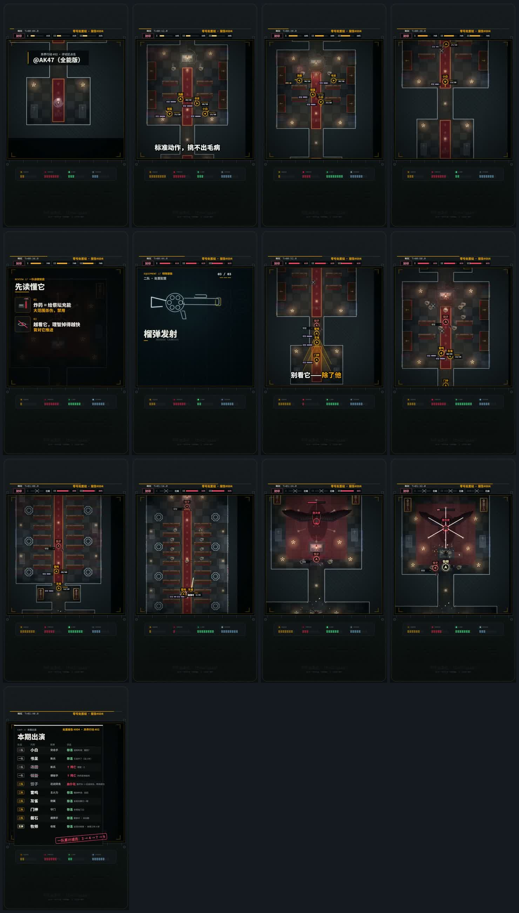
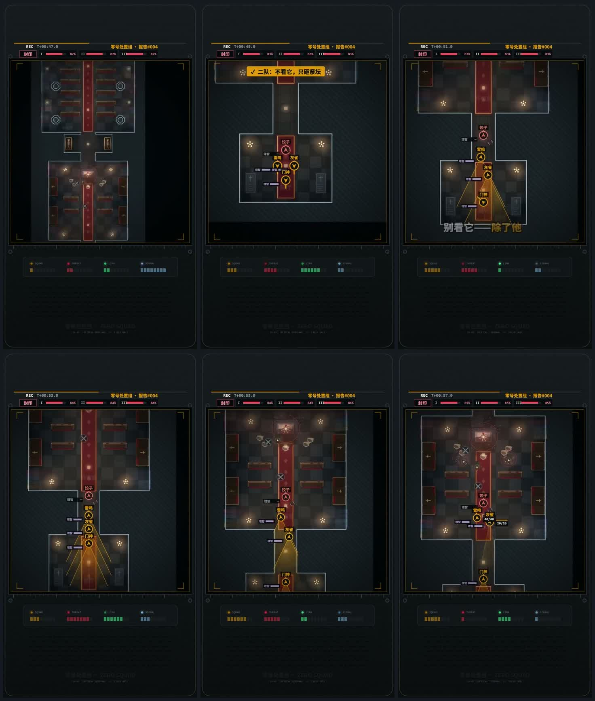
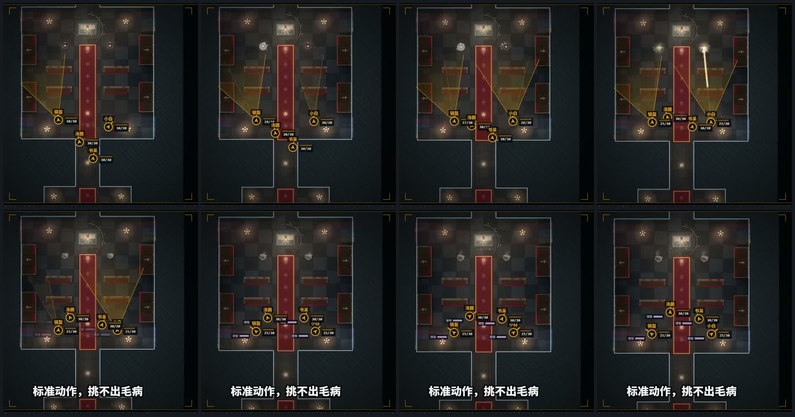
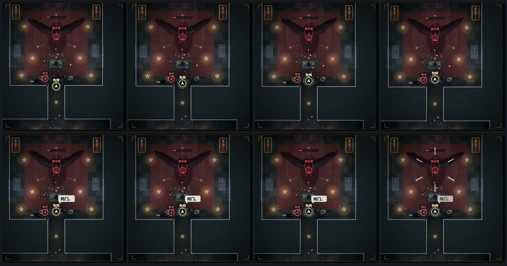

# 原型参考：来源、摘帧与验收要点

## 核心目的

把本会话已观察的地图、单位图标、射界和枪械演出保存为项目内稳定参考，防止后续只凭文字猜风格，或把自动回放视频误当成已经存在的可操作战棋。

## 具体任务

- 保存四张此前提取的缩略图，不把临时目录或用户本机视频缓存路径写进对外使用说明。
- 圆形头像替代视频中方向圆标，保留二维顶视地图、方向、局部光照和几何特效；其余操作与玩法以 [规则规格](../SPEC.md) 为准。
- 本页是参考资料，不是可玩Demo、程序截图或功能完成报告。

## 视频出处与观察边界

- 主参考：[零号处置组：不许用炸药，怎么拆三座祭坛？](https://www.bilibili.com/video/BV1p6WH6ZELZ)
- 另一个链接参考：[同一只吸血鬼，一队翻车，二队零伤亡，差在哪？【处置报告#001】](https://www.bilibili.com/video/BV1Y9446NEzQ)
- 用户上传的主视频：720×1280、30fps、约107.766625秒。只保存摘帧图，不提交整段视频。
- 原视频SHA-256：`577dd5743ae2d59d313a7e80f32a7d2d61ad1bc727798f2e66c7cbcb087f9ac9`。
- 主代理实际检查的是全片总览、局部连续摘帧；agy视频读取尝试超时，没有取得可用分析，不将其记录为观看成功。用户另提供了逐2秒摘帧分析，本页将可核对的视觉要点结合保留。
- 未以原音轨做声音设计判断。无法从画面证明作者使用HTML、某个引擎或Agent制作，也无法证明视频背后支持玩家操作。

## 已保存的四张原型缩略图

### 1. 全片总览

- 文件：[prototype-overview.jpg](prototype-overview.jpg)，174025字节。
- SHA-256：`b6fa9e8378fb789994190fc77021651ea344b78a2d28e8d52bf02cc23ad9c339`。
- 每8秒取样、缩到360像素宽、4×4拼图；读取顺序从左至右、从上至下，尾部空格没有额外内容。显示地图推进、装备／复盘插卡、末段目标和结算。

### 2. 战斗与射界细节（约47—57秒）

- 文件：[prototype-combat-detail.jpg](prototype-combat-detail.jpg)，126249字节。
- SHA-256：`49344be900cd3fe080959af830c3fd6805ca15214ad6bab8f86511db1fd05420`。
- 从46秒截取12秒、每2秒取样、3×2拼图，播放器内REC读数约47、49、51、53、55、57秒。
- 可见分队推进、金色锥形、名称、理智条、地图房间与通道。视频的锥形可能表示警戒／视野；本项只参考画法，不能推断它就是技能攻击范围。

### 3. 枪口与弹道连续摘帧（约10—12秒）

- 文件：[prototype-gunfire-sequence.jpg](prototype-gunfire-sequence.jpg)，126376字节。
- SHA-256：`678d5e639a1c3b6390cff4af826c4b01845050ada937c07cc708c410df68d5fa`。
- 截10秒起2秒，每秒4帧；裁出战场后4×2拼图，约0.25秒间隔，时间用于定位而非精确音画帧同步。
- 可见方向圆标、枪口短闪、亮线、目标区域火星和状态条变化，作为地图上“谁向哪里开火”的视觉标准。

### 4. 目标与技能命中连续摘帧（约90—92秒）

- 文件：[prototype-target-impact-sequence.jpg](prototype-target-impact-sequence.jpg)，114897字节。
- SHA-256：`49d55a1112c025f3785819c56b0df5714171432b63df1d52c2740d7b887fe469`。
- 截90秒起2秒，每秒4帧，战场裁图4×2拼图。
- 可见大型目标、圆标、局部对白、命中光线／火星。角色人物画风无需沿用，圆形头像外环和朝向箭头是新前端目标。

## 对应视觉验收目标

| 项 | 保留的参考 | 不作隐含要求 |
| --- | --- | --- |
| 地图 | 正交俯视、深灰石砖／红毯、墙体描边、房间与长廊、局部暖光 | 不固定教堂这一张地图，不要求逐像素真实光照，不改成等距像素棋盘 |
| 单位 | 清晰圆形阵营环、名称、就近状态、独立朝向 | 头像不随朝向旋转，不能把单格头像当作所有单位真实占地 |
| 射界 | 半透明方向区域、细边界、遮挡可读 | 不因视觉扇形自动获得警戒射击，不用另一套纯视觉范围替代规则预览 |
| 枪械 | 起点短闪、沿方向亮线、终点火星、实际结果反馈 | 不做弹匣、换弹、持武器切换，不以视频音轨决定新音频资源 |
| 镜头 | 只关注当前行动及相关对象，平滑平移缩放 | 不把多个单位连续自动同步推进当作新玩法；规则始终完全回合制 |
| 叙事 | 气泡、记录和结果的清晰层次 | 不要求照搬复盘剪辑、装备卡、竖屏手机录像框和自动演播 |

## 摘帧方法记录

原文件只作为ffmpeg输入，不在其目录运行脚本或构建。既有图片由临时分析目录复制至本目录，复制后核对SHA-256一致；本轮没有再次生成或筛选另一套视频素材。

- 总览滤镜：`fps=1/8,scale=360:-1,tile=4x4:padding=8:margin=8:color=0x151922`。
- 战斗细节：起46秒、长12秒；`fps=1/2,scale=480:-1,tile=3x2:padding=8:margin=8:color=0x151922`。
- 两组连续帧：分别起10与90秒、长2秒；`fps=4,scale=540:-1,crop=496:520:22:156,tile=4x2:padding=8:margin=8:color=0x151922`。

本页记录生成方法，不要求用户手工拼接或执行命令。四图是参考，不是项目美术资产或已验证交付截图。
